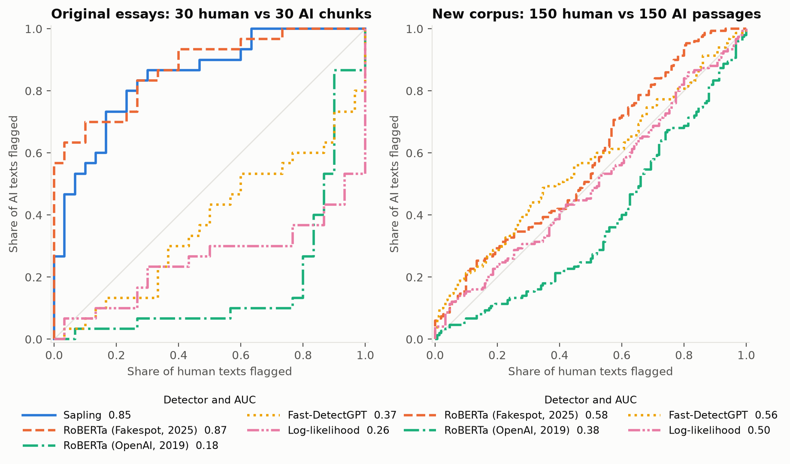
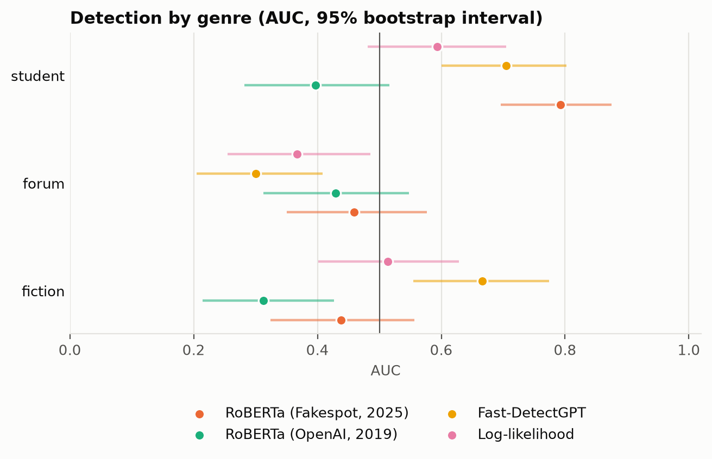
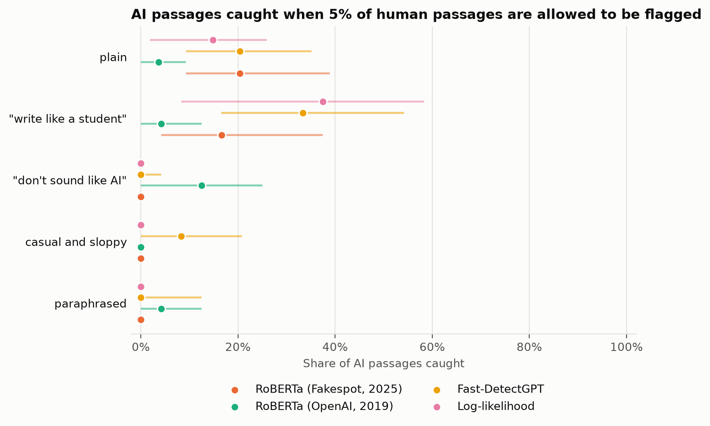
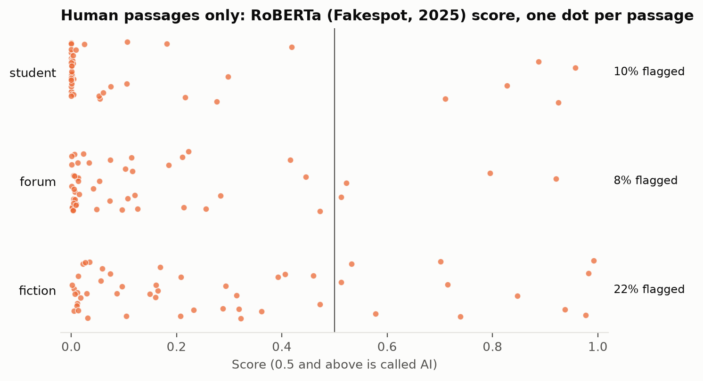

# Can an AI detector spot AI writing?

This started as a senior stats project about Sapling AI's detector. The first version took five student essays, had an AI rewrite them to different degrees, cut them into 100-word chunks, sent the chunks to Sapling, and then asked whether Sapling's score landed near the share of AI the essay was supposed to contain. That last part was the wrong question. A detector doesn't claim to measure a percentage, so testing it against one tells you little. The question that matters is simpler: given a piece of text, can the score tell human writing from AI writing, and what does it cost in wrongly accused humans?

The rebuilt project asks only that. It also has a problem the old one couldn't escape: Sapling's API costs money, so Sapling was never run on anything new. Its 119 original scores are a fixed dataset, and everything else here uses free detectors that run on a laptop GPU.

The short version is that the free detectors do much worse than I expected, and the original Sapling results are not as flattering as the old README said.

## What was wrong with the first version

Reading the old code turned up a few real problems. `analysis.py` read from a folder (`stat_results`) that didn't exist, while the data was in `detection_results`. The condition check for the z-test had an operator-precedence bug (`not (a) and (b)` where `not (a and b)` was meant). The docstring in `detection.py` said Winston while the code called Sapling. The z-tests treated six chunks from one essay as six independent observations, which overstates the evidence, and with five essays the whole thing was fragile anyway. Compiled `__pycache__` files were committed. Results were saved as Python dict reprs and read back with `ast.literal_eval`.

The old README concluded that Sapling could tell, with statistical significance, whether an essay was fully generated or heavily edited. The old tables did show the other side (only a third of the human chunks were classed correctly), but the writeup leaned on the AI half. Two thirds of the human chunks got flagged, and that deserved more than a footnote.

`detection.py` was also the only code that talked to Sapling, and it skipped cached results by checking the wrong directory, so running it twice would have re-sent every chunk. It's deleted. Nothing in this repo can call Sapling now.

## How the data was built

Human text comes from three open sources, all written before 2021 so that no model could have touched it: Stack Exchange answers (CC BY-SA), public-domain fiction from Project Gutenberg, and PERSUADE 2.0, a corpus of essays by US students in grades 6 to 12 (CC BY 4.0). I took 50 passages from each, 80 to 400 words, cut at sentence boundaries. Source, license, URL and date for every passage are in `data/metadata.csv`. I had planned news, encyclopedia and speech genres from Wikimedia too, but Wikimedia limits scripts without contact details to 10 requests a minute and that collection was crawling, so I dropped it. That leaves three genres, which is thinner than I wanted.

AI text was written directly by Claude (Anthropic's model, Fable 5.2, the model running this session). No API, no local model and no script produced any of it. Each of the 180 passages is a file a model wrote by hand after reading an instruction. The 156 non-paraphrase passages were written in six parallel writing sessions, each given the same instructions, about 26 passages each; the 24 paraphrases were written afterwards in the main session. Three of the six sessions hit a usage limit and were cut off after saving all their files but before reporting back. I checked their lengths and shortened six overlong passages from one of them by deleting sentences by hand. I can't vouch for what those three sessions did beyond what the files show. The exact instruction for every passage is in `data/ai/assignments.csv`.

Each AI passage is tied to a specific human passage, its twin, and was asked to match that passage's subject, length, and position in its document (the opening of a forum answer, the middle of a chapter) without reusing its wording. The instruction came in five flavors, and the point of those is to make the hard cases hard:

| Style | What Claude was told | Passages |
|---|---|---|
| plain | nothing, write it naturally | 54 |
| student | write like an ordinary American high school student | 24 |
| anti_ai | avoid stock phrases, tidy lists, hedging, neat endings; vary sentence length | 24 |
| casual | write fast and sloppy, typos and run-ons included | 24 |
| paraphrase | reword an earlier plain passage, same content and length | 24 |

Length and genre are controlled by construction. Every AI passage was written to its twin's word count, and came out between 0.92 and 1.10 times its target (mean ratio by style from 0.99 to 1.05, `results/tables/length_match.csv`). Word count alone separates the two groups with an AUC of 0.53 (95% interval 0.46 to 0.60), so length isn't what any detector is picking up. One leftover difference: 62% of the human fiction passages contain an em dash (Gutenberg writes them as double hyphens, which I converted) against 8% of the AI fiction passages. I checked whether the detectors care, and they don't detectably: among human fiction passages, those with and without a dash score about the same (AUC of 0.49 for Fakespot, interval 0.31 to 0.65).

The corpus:

| Set | Human | AI | Used for |
|---|---|---|---|
| main | 150 (50 forum, 50 fiction, 50 student) | 150 (50 per genre) | everything except the two below |
| English-learner probe | 100 | none | do detectors flag non-native writers? |
| imitation probe | 30 real student essays | 30 AI imitations, one per essay | can the AI imitate a specific student? |

The original five essays and their Sapling scores are kept as a separate labeled subset: 30 human chunks, 30 fully-AI chunks, and 59 chunks from the "25%" and "75%" hybrid versions. The hybrids have no clean label, so they only appear in one clearly marked side analysis.

## What was measured

Every detector gives a score where higher means more AI-like. I treat it as a ranking and ask how well the ranking separates the two groups, since a detector's absolute scale tells you nothing about whether it works.

The main number is ROC-AUC: the chance that a random AI passage scores above a random human one. 0.5 is a coin flip and 1.0 is perfect. Below 0.5 means the detector is backwards.

The number that matters in practice is the true positive rate at a fixed false positive rate. Accusing a human of using AI is the expensive mistake, so I fix the false positive rate at 1% or 5% (by choosing the cutoff from the human scores) and report what share of AI text gets caught. A detector that's only good at a 50% false positive rate is useless for the job.

The plain binary hit rate at a 0.5 cutoff appears once, for the three detectors that output something shaped like a probability. It's reported with an interval but nothing is built on it.

All intervals are 95% bootstrap intervals that resample whole source documents, not passages: chunks of one essay move together, and a paraphrase moves with the passage it paraphrases. Human and AI documents are resampled separately so group sizes stay fixed. The p-values come from permutation tests that shuffle group labels between documents, or, for paraphrases against their sources, an exact or Monte Carlo sign-flip test. Within each family of tests I adjust with Holm's method. The statistics are in `statproject/stats.py` and are tested against hand-computed cases in `tests/`.

The local detectors, used only to score text:

- RoBERTa (Fakespot, 2025): a fine-tuned RoBERTa classifier trained on output from recent chat models.
- RoBERTa (OpenAI, 2019): OpenAI's GPT-2 era detector, kept as a dated baseline. I confirmed against OpenAI's own server code that class 0 is "fake", so the score really is P(AI).
- Fast-DetectGPT: a zero-shot method that asks whether text is unusually probable compared with what the scoring model, GPT-Neo 2.7B, would typically write. My implementation of the formula is tested against hand calculations and against a simulation where text sampled from the model should score like a standard normal.
- Log-likelihood: the classic average token log-probability under the same model, the old "perplexity detector."

## Results

### Sapling on the original essays

This is the only data Sapling saw, and it's 5 essays.

| | Sapling |
|---|---|
| AUC, human vs fully-AI chunks | 0.85 (0.75 to 0.95) |
| AI chunks caught at 5% false positives | 47% (20% to 80%) |
| AI chunks caught at 1% false positives | 27% (13% to 77%) |
| Flagged at the 0.5 cutoff | 100% of AI chunks, 67% of human chunks |
| Hit rate at 0.5 | 67% (53% to 80%) |

So the ranking is decent and the cutoff is bad. Sapling put every AI chunk above 0.5 and also flagged 20 of the 30 human chunks, and the human essays are not equally affected: essays 1 and 4 were flagged in every chunk, while essay 3 was flagged in a third. Mean score per essay and version:

| Essay | Human | "25% AI" | "75% AI" | Fully AI |
|---|---|---|---|---|
| 1 | 0.88 | 0.99 | 0.98 | 0.98 |
| 2 | 0.69 | 0.37 | 0.90 | 0.90 |
| 3 | 0.40 | 0.01 | 1.00 | 1.00 |
| 4 | 0.97 | 0.94 | 0.99 | 1.00 |
| 5 | 0.48 | 0.25 | 0.98 | 0.94 |

In every one of the five essays the AI version outscored the human original, and in three of them (2, 3 and 5) the lightly AI-edited version scored lower than the human original did. The hybrid side analysis agrees: against the human originals, the 25% versions have an AUC of 0.43 (0.20 to 0.67), meaning no detectable signal, while the 75% versions reach 0.86 (0.73 to 0.97). The essays that got a bit of AI help read as more human to Sapling than the untouched human ones.

Five essays out of five in the right direction sounds convincing, and the exact paired test says p = 0.0625. That is the smallest p-value a five-essay sign test can produce, so this sample cannot reach significance at 0.05 whatever the data look like. It supports "probably better than chance" and not much more.

### The free detectors on the new corpus

On the 150 human and 150 AI passages, the detectors were far worse than the original essays suggested.

| Detector | AUC | AI caught at 5% FPR | AI caught at 1% FPR | Holm p for AUC = 0.5 |
|---|---|---|---|---|
| RoBERTa (Fakespot) | 0.58 (0.51 to 0.64) | 10% (5% to 18%) | 7% | 0.078 |
| Fast-DetectGPT | 0.56 (0.49 to 0.63) | 14% (8% to 23%) | 7% | 0.139 |
| Log-likelihood | 0.50 (0.43 to 0.57) | 11% (3% to 18%) | 4% | 0.949 |
| RoBERTa (OpenAI 2019) | 0.38 (0.31 to 0.45) | 5% (1% to 8%) | 1% | 0.001 |

Averaged over everything, three of the four can't be told apart from a coin flip, and the fourth is significantly worse than one. The 2019 detector is backwards: it rates modern chatbot text as more human than the human text. At the 0.5 cutoff Fakespot flagged 13% of human passages and 24% of AI passages, a hit rate of 55% (51% to 60%).

The twin comparison says the same thing from another angle. Pairing each AI passage with the human passage it was written to match, the AI one scored higher only 52% of the time for Fakespot (44% to 60%) and 56% of the time for Fast-DetectGPT (48% to 65%).

The averages hide a lot, though, which is where it gets interesting.



### Where detection works and where it breaks

Genre. The same detector is good in one genre and wrong-way-round in another. Fakespot on student essays reaches an AUC of 0.79 (0.70 to 0.88), and on plain-prompted AI essays specifically, 0.94 (0.88 to 0.98) with 56% caught at a 5% false positive rate. On forum answers its AUC is 0.46 and on fiction 0.44. Fast-DetectGPT does best on fiction (0.67, and 0.76 for plain prompts) and is clearly backwards on forum answers (0.30, interval 0.21 to 0.41). Why, I can't say for certain. My guess is that forum answers are short, informal and written in the plain, predictable phrasing these methods read as machine-like, so the human answers look more AI-like than the AI ones did. The student-essay result is the one case where a free detector does what it's advertised to do, and it happens to be the genre the original project used.



Length. Longer passages are easier: for passages of 250 words or more, Fakespot reaches an AUC of 0.67 (0.56 to 0.78) and Fast-DetectGPT 0.72 (0.61 to 0.83), against about 0.5 for the 150 to 249 word range. Length is tangled up with genre here (more than half of the passages under 150 words are forum answers), so I wouldn't read this as a clean length effect.

Writing style. This is the clearest result in the project. Against all 150 human passages:

| AI passages written as | n | Fakespot AUC | Fast-DetectGPT AUC | Log-likelihood AUC | Fakespot catches at 5% FPR |
|---|---|---|---|---|---|
| plain | 54 | 0.72 (0.65 to 0.79) | 0.64 (0.55 to 0.73) | 0.62 (0.53 to 0.70) | 20% |
| student | 24 | 0.72 (0.61 to 0.82) | 0.82 (0.74 to 0.89) | 0.81 (0.71 to 0.89) | 17% |
| anti_ai | 24 | 0.37 (0.29 to 0.47) | 0.37 (0.24 to 0.49) | 0.33 (0.24 to 0.43) | 0% |
| casual | 24 | 0.35 (0.25 to 0.44) | 0.48 (0.36 to 0.60) | 0.19 (0.12 to 0.27) | 0% |
| paraphrase | 24 | 0.54 (0.44 to 0.64) | 0.42 (0.31 to 0.54) | 0.42 (0.32 to 0.53) | 0% |

Telling the model to avoid AI phrasing, or to write sloppily, pushed the AUC to or below the coin-flip line for every detector: for most of them, these passages look more human than the real human text. Compared with plain AI text, the drop in Fakespot's score was about 0.37 for both styles (Holm-adjusted p = 0.002 each). Paraphrasing a plain passage lowered the score in 18 of 24 pairs for Fakespot (mean drop 0.29, Holm p = 0.014), in 21 of 24 for Fast-DetectGPT, and in all 24 for log-likelihood. At 5% false positives, Fakespot catches none of the anti-AI, casual or paraphrased passages.

"Write like a high school student" did not help the AI hide. For Fakespot the scores don't differ from plain AI text (Holm p = 1), and for the two likelihood-based detectors the student-voice text was easier to catch, not harder (Holm p = 0.025 for log-likelihood; 0.16 for Fast-DetectGPT). The imitation probe, where Claude wrote an essay to match one specific real student's level of polish and mistakes, tells a mixed story: Fast-DetectGPT still caught it (AUC 0.85, interval 0.73 to 0.93, with 50% caught at 5% false positives) while Fakespot mostly did not (AUC 0.60, 0.44 to 0.73). My guess, which I haven't tested, is that deliberate errors don't change how predictable the underlying word choices are, while the instruction to be concrete and unpolished does.



### False positives

At the 0.5 cutoff, Fakespot flagged 20 of the 150 human passages (13%): 11 of the 50 fiction passages (22%), 5 of 50 student essays (10%), and 4 of 50 forum answers (8%). Fast-DetectGPT and log-likelihood don't output a probability, so there's no 0.5 to apply; at the cutoff that allows 5% of all human passages to be flagged, the human passages that exceed it are 8% of fiction, 4% of student essays and 2% of forum answers for Fakespot.



The flagged passages are not what I expected. I tested whether flagged human text differed in length, sentence and word length, commas, contractions, first-person pronouns, quotation marks, digits or vocabulary variety (ten simple features of each passage), and compared within genre so that "fiction is long and commas are common" didn't masquerade as a finding. After Holm adjustment nothing survives. The nominal hits are weak: longer passages scored slightly lower (within-genre rank correlation of -0.17 for Fakespot, p = 0.04 before adjustment, 1.0 after). Whatever makes a human passage look AI-like to these detectors, a simple surface feature doesn't capture it. The 20 are 11 fiction passages, 5 student essays and 4 forum answers, including one about travel safety during COVID and one about splitting a boulder. I couldn't find anything else that unites them.

English learners. A well-known worry is that detectors flag non-native writers. I compared 50 essays by students marked as English language learners to 50 non-learner essays on the same prompt at the same grade level, all human. I didn't see it. Fakespot scored the learner essays lower: a learner essay outscored its non-learner counterpart only 24% of the time (15% to 34%), 0% of learner essays were flagged at 0.5 against 14% of the others, and the difference is significant after correction (Holm p < 0.001). Log-likelihood agrees (27%, Holm p = 0.001). The 2019 detector and Fast-DetectGPT show nothing. My guess is that these essays are short, error-filled and plainly written, which looks human to a detector trained on fluent chatbot output, but I haven't tested that. It also says nothing about Sapling.

### Does Sapling agree with the free detectors?

Only on the 119 original chunks, and only partly. Fakespot is the one that tracks Sapling: Spearman correlation 0.48 (0.29 to 0.62), and the same call at 0.5 on 82% of chunks. On those same human-versus-AI chunks Fakespot's AUC is 0.87 (0.72 to 0.98), with heavily overlapping intervals against Sapling's 0.85. The other three disagree: the 2019 detector correlates negatively with Sapling (-0.31), and Fast-DetectGPT and log-likelihood show no relationship (-0.07 and -0.21, both intervals including zero). On the original essays the zero-shot detectors score below chance as well (AUC 0.37 and 0.26), which is a good reason not to treat them as stand-ins for Sapling.

## What didn't work or surprised me

I assumed the free detectors would roughly match Sapling and give me a way to estimate how Sapling would do on the new corpus. They don't, so I can't estimate that, and I haven't tried.

I expected style tricks to help the AI a bit. They help it a lot. The size of the drop from asking for sloppy or non-AI-sounding prose surprised me more than anything else here, partly because the instruction is a single sentence.

I expected English learners to be the false positive story. They were the opposite.

Getting the human text took longer than anything else, mostly because of the rate limit on Wikimedia. Dropping that source left a corpus with only three genres, and one of them (public-domain fiction, mostly 1880s to 1950s) is not a great match for the AI pastiche it's paired with.

## Limits

Sapling was only ever tested on five essays. Nothing here supports a claim about how Sapling does on forum answers, fiction, or any other student's essays, and the interval on its true positive rate at 5% false positives runs from 20% to 80%.

There is one AI writer, and it is a recent frontier model told to write in specific ways. Detectors trained on, or tuned against, other models may behave differently, and Claude's attempts at "sloppy" or "student" writing are its own interpretation of those instructions. Six writing sessions of the same model aren't six independent writers. Per-session AUCs for Fakespot ranged from 0.50 to 0.64 with overlapping intervals, so no session stands out.

The analysis violates some assumptions. The human and AI passages are matched on topic and length, but I resample the two groups independently, which ignores the pairing. Style comparisons use 24 passages per cell, so those intervals are wide. A percentile bootstrap breaks down when the estimate sits at zero (several true positive rates are exactly 0% with an interval of 0% to 0%, which should be read as "too small to measure," not "known to be zero"). The p-values are Monte Carlo with 10,000 permutations, so none can be smaller than about 0.0001; "p < 0.001" in the text means that. And I ran many comparisons: I corrected within each family, but there are several families, and a few of the quieter results here would not survive being counted together.

The English-learner flag in PERSUADE is coarse and self-reported. The human text was filtered by date or by source, but I didn't check publication years for each Gutenberg book individually, and PERSUADE's dates come from the authors' description, not my own check.

## Reproducing

The corpus and all scores are committed, so the evaluation reruns without downloading anything beyond two Hugging Face models if you want to rescore.

```bash
python -m venv .venv
.venv/Scripts/python -m pip install -r requirements.txt
```

For a GPU, install `torch` from pytorch.org first so pip doesn't pull the CPU build. Then:

```bash
python -m statproject score      # runs the four local detectors over every text (downloads three models, about 12 GB)
python -m statproject evaluate   # writes results/tables and results/figures
python -m pytest                 # statistics, text handling, and the Fast-DetectGPT formula
```

`python -m statproject collect` re-downloads the human passages, but the Stack Exchange and Gutenberg listings change over time, so a fresh run will give different passages from the committed ones; the committed `data/` is the dataset. The collect command refuses to run if `data/metadata.csv` exists. The AI passages cannot be regenerated, because the model wrote them by hand; `data/ai/assignments.csv` records what each was asked to do. `plan-ai` and `register-ai` are the two steps used to build that file and fold the written passages into the metadata.

No API key is needed for anything, and nothing in the code contacts Sapling.

Layout: `data/human` and `data/ai` hold the passages, `data/metadata.csv` the one table that describes them, `data/scores` the local detector scores, `data/legacy` the original essays, their raw Sapling results and `chunks.csv` (the same results as a single file). Code is in `statproject/`, one module per job (`sources/`, `collect`, `assignments`, `detectors`, `features`, `stats`, `evaluate`, `plots`) with `cli.py` as the entry point.
