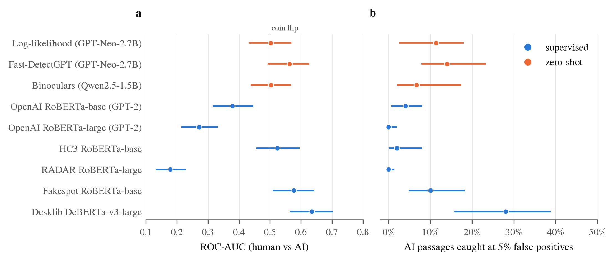
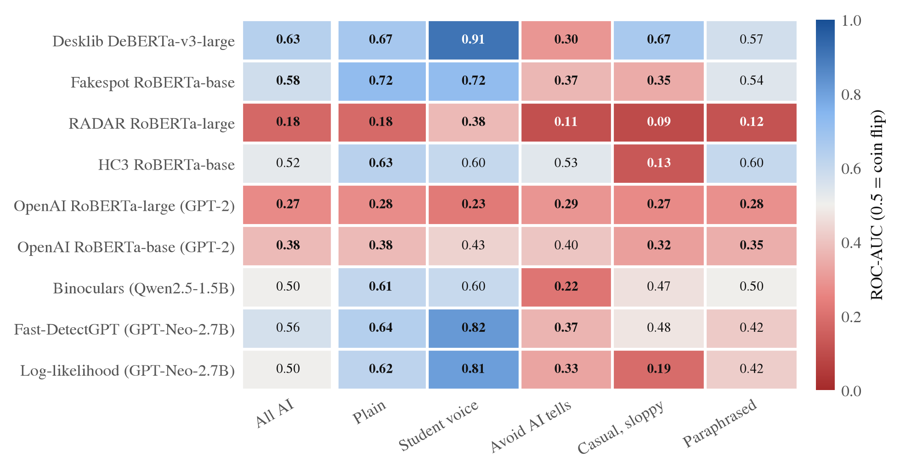
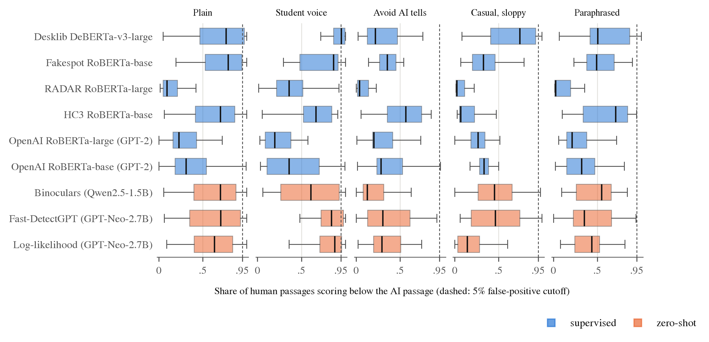
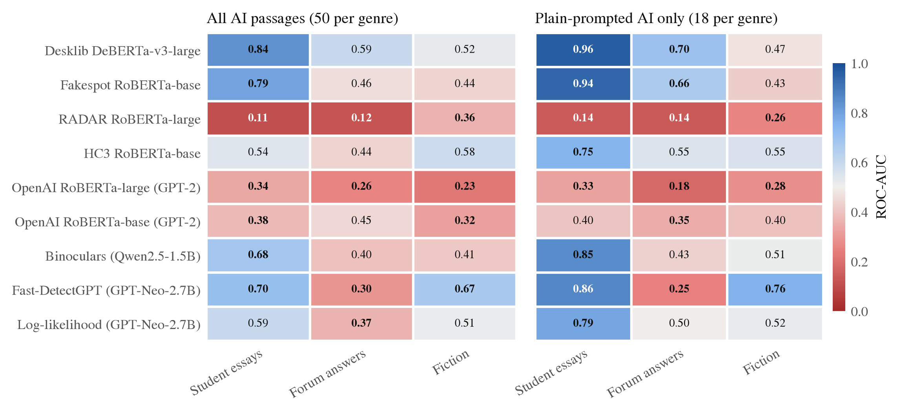
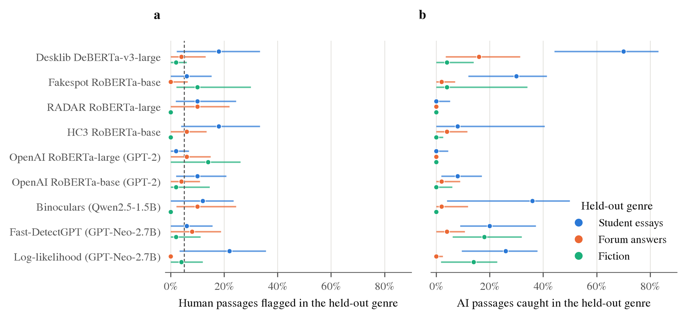
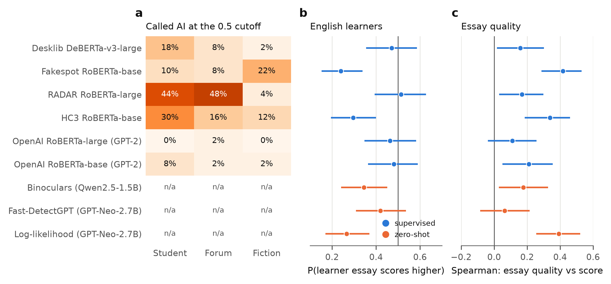
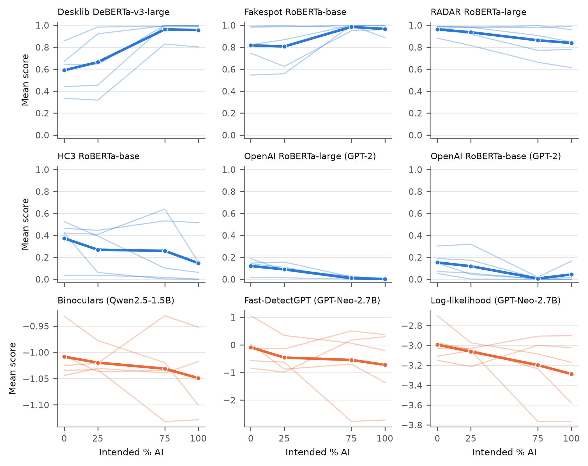

# Can free AI-text detectors catch AI writing?

This repo tests nine open-source AI-text detectors on 300 matched human and AI passages. The best one, Desklib's DeBERTa-v3-large, catches 28% of AI passages at a 5% false positive rate, and several others catch almost none. RADAR and the two 2019 GPT-2 detectors do worse than chance: they score modern chatbot text as more human than real human text. Adding one sentence to the prompt that tells the model to avoid sounding like AI pushed five of the six detectors that beat chance on plain AI text below chance.

## How the data was built

Human text comes from three open sources, all written before 2021 so that no chatbot could have touched it: Stack Exchange answers (CC BY-SA), public-domain fiction from Project Gutenberg, and PERSUADE 2.0, a corpus of essays by US students in grades 6 to 12 (CC BY 4.0). I took 50 passages from each (plus extra student essays for two side checks), roughly 80 to 380 words, cut at sentence boundaries. Source, license, URL and date for every passage are in `data/metadata.csv`.

The AI text was written by Claude, one passage at a time, from a written instruction. The 156 non-paraphrase passages were written by Claude Fable 5.2 in six batches of about 26 passages each. The 24 paraphrases were written afterwards by Claude Sonnet 5.5, so they come from a different model than the passages they paraphrase. I checked lengths and shortened six overlong passages by deleting sentences by hand. The exact instruction for every passage is in `data/ai/assignments.csv`.

Each AI passage is paired with a human passage, its twin, and was asked to match that passage's subject, length and position in its document (the opening of a forum answer, the middle of a chapter) without reusing its wording. The instructions came in five styles, several of them chosen to make detection harder:

| Style | What Claude was told | Passages |
|---|---|---|
| plain | nothing, write it naturally | 54 |
| student | write like an ordinary American high school student | 24 |
| anti_ai | avoid stock phrases, tidy lists, hedging, neat endings; vary sentence length | 24 |
| casual | write fast and sloppy, typos and run-ons included | 24 |
| paraphrase | reword an earlier plain passage, same content and length | 24 |

Genre and length are matched by construction. Every AI passage was written to its twin's word count and came out between 0.92 and 1.09 times its target (`results/tables/length_match.csv`). Word count alone separates the two groups with an AUC of 0.53 (95% interval 0.46 to 0.60), so length isn't driving any detector. One difference remains: 62% of the human fiction passages contain an em dash (Gutenberg writes them as double hyphens, which I converted) against 8% of the AI fiction passages. No detector's scores differ detectably between human fiction passages with and without one (every interval includes 0.5).

| Set | Human | AI | Used for |
|---|---|---|---|
| main | 150 (50 forum, 50 fiction, 50 student) | 150 (50 per genre) | nearly everything |
| English-learner probe | 100 student essays | none | do detectors flag non-native writers? |
| imitation probe | 30 student essays | 30 AI imitations, one per essay | can the AI imitate a specific student? |
| essay rewrites | 5 student newspaper essays | the same 5 rewritten by an AI at 25%, 75% and 100% | does detection track the share of AI? |

The essay-rewrite set is the original project's data: 118 chunks of about 100 words. Its human essays were written in 2024, after chatbots were widely available, so their label rests on the authors' word, not a date. The 25% and 75% versions are hybrids with no clean label and appear in only one analysis.

## The detectors

All are free and run locally on a laptop GPU. Every score is oriented so that higher means more AI-like.

| Detector | Type, year | Notes |
|---|---|---|
| Desklib DeBERTa-v3-large | supervised, 2025 | fine-tuned on the RAID benchmark; MIT license |
| Fakespot RoBERTa-base | supervised, 2025 | its model card doesn't list the training data; Apache-2.0 |
| RADAR RoBERTa-large | supervised, 2023 | trained against a paraphraser, on Vicuna-7B text; non-commercial license |
| HC3 RoBERTa-base | supervised, 2023 | trained on ChatGPT answers (the HC3 corpus); license not stated |
| OpenAI RoBERTa-large and -base | supervised, 2019 | trained on GPT-2 output; MIT; kept as dated baselines |
| Binoculars | zero-shot, 2024 | my implementation with a Qwen2.5-1.5B and Qwen2.5-1.5B-Instruct pair, not the paper's Falcon-7B pair, which won't fit on this GPU |
| Fast-DetectGPT | zero-shot, 2024 | scored with GPT-Neo-2.7B |
| Log-likelihood | zero-shot, 2019 | the classic perplexity detector, same model |

RADAR's result below is extreme enough that a flipped label is the obvious suspect, so I checked the label direction of every classifier against its authors' code. RADAR's hosted demo takes the probability of AI text from output index 0, which is what I use, and OpenAI's server code unpacks its output as (fake, real). The two zero-shot formulas are tested against hand calculations in `tests/`. Model commit hashes are in `data/scores/models.json`.

## What was measured

I treat each detector's score as a ranking and ignore what the number means. The main metric is ROC-AUC, the chance that a random AI passage outscores a random human one: 0.5 is a coin flip, 1.0 is perfect, and below 0.5 means the detector is backwards.

For practical use I also report the share of AI text caught at a fixed false positive rate, since wrongly accusing a human is the costly mistake. The cutoff is set to flag 1% or 5% of human passages, and I report what share of AI passages exceed it. For detectors that output a probability, I also report a 0.5 cutoff.

All intervals are 95% bootstrap intervals that resample whole source documents rather than passages, so a paraphrase moves with the passage it paraphrases and the five rewrite essays resample as five units. Human and AI documents are resampled separately to keep group sizes fixed. P-values come from permutation tests that shuffle group labels between documents, or from a paired sign-flip test for paraphrases against their sources, adjusted with Holm's method within each family of tests. The code is in `src/stats.py` and is tested against hand-computed cases in `tests/`.

## Results

### Overall



*Figure 1. Nine detectors on 150 human and 150 AI passages. (a) ROC-AUC with 95% bootstrap intervals. (b) Share of AI passages caught when the cutoff allows 5% of human passages through.*

| Detector | Family, year | AUC | Caught at 5% FPR | Caught at 1% FPR | Holm p |
|---|---|---|---|---|---|
| Desklib DeBERTa-v3-large | supervised, 2025 | 0.63 (0.56 to 0.70) | 28% (16% to 39%) | 18% | 0.003 |
| Fakespot RoBERTa-base | supervised, 2025 | 0.58 (0.51 to 0.64) | 10% (5% to 18%) | 7% | 0.130 |
| RADAR RoBERTa-large | supervised, 2023 | 0.18 (0.13 to 0.23) | 0% (0% to 1%) | 0% | <0.001 |
| HC3 RoBERTa-base | supervised, 2023 | 0.52 (0.46 to 0.60) | 2% (0% to 8%) | 1% | 1.000 |
| OpenAI RoBERTa-large (GPT-2) | supervised, 2019 | 0.27 (0.21 to 0.33) | 0% (0% to 2%) | 0% | <0.001 |
| OpenAI RoBERTa-base (GPT-2) | supervised, 2019 | 0.38 (0.32 to 0.45) | 4% (1% to 8%) | 2% | 0.003 |
| Binoculars (Qwen2.5-1.5B) | zero-shot, 2024 | 0.50 (0.44 to 0.57) | 7% (2% to 17%) | 3% | 1.000 |
| Fast-DetectGPT (GPT-Neo-2.7B) | zero-shot, 2024 | 0.56 (0.49 to 0.63) | 14% (8% to 23%) | 7% | 0.279 |
| Log-likelihood (GPT-Neo-2.7B) | zero-shot, 2019 | 0.50 (0.43 to 0.57) | 11% (3% to 18%) | 4% | 1.000 |

The p-value tests whether the AUC differs from 0.5. Only Desklib is significantly above chance, and its lead over the next best detector, Fakespot, is not significant (AUC difference 0.06, interval -0.02 to 0.14). RADAR and the two OpenAI models are significantly below chance. RADAR, which was trained to resist paraphrasing, rates real human text as AI more often than it rates the AI passages: at a 0.5 cutoff it flags 32% of human passages and 2% of AI ones, including 44% of the real student essays and 48% of the real forum answers. The 2019 detectors almost never flag the AI text, which looks nothing like GPT-2's output.

Pairing each AI passage with its own human twin gives the same ranking: Desklib scored the AI passage higher in 70% of pairs (62% to 78%) while RADAR did in 11% (6% to 17%).

### Effect of the prompt style



*Figure 2. ROC-AUC against all 150 human passages, by how the AI passages were written. Bold means the 95% interval excludes 0.5. Blue means the detector ranks AI text higher, red means it ranks AI text lower than human text.*

| Detector | plain (n=54) | student (24) | anti_ai (24) | casual (24) | paraphrase (24) |
|---|---|---|---|---|---|
| Desklib DeBERTa-v3-large | 0.67 / 37% | 0.91 / 58% | 0.30 / 0% | 0.67 / 21% | 0.57 / 12% |
| Fakespot RoBERTa-base | 0.72 / 20% | 0.72 / 17% | 0.37 / 0% | 0.35 / 0% | 0.54 / 0% |
| HC3 RoBERTa-base | 0.63 / 6% | 0.60 / 0% | 0.53 / 0% | 0.13 / 0% | 0.60 / 0% |
| Binoculars (Qwen2.5-1.5B) | 0.61 / 9% | 0.60 / 12% | 0.22 / 0% | 0.47 / 8% | 0.50 / 0% |
| Fast-DetectGPT (GPT-Neo-2.7B) | 0.64 / 20% | 0.82 / 33% | 0.37 / 0% | 0.48 / 8% | 0.42 / 0% |
| Log-likelihood (GPT-Neo-2.7B) | 0.62 / 15% | 0.81 / 38% | 0.33 / 0% | 0.19 / 0% | 0.42 / 0% |

*Each cell is AUC / share of AI passages caught at 5% false positives. The three detectors that are already backwards on plain AI text (RADAR and the two OpenAI models) are in Figure 2 and `results/tables/by_style.csv`.*

Six detectors beat chance on plain AI text. For five of them (Desklib, Fakespot, Binoculars, Fast-DetectGPT and log-likelihood), telling the model to avoid AI phrasing lowered the score significantly (Holm-adjusted p of 0.004 or 0.005), and none then catches any of the 24 passages at 5% false positives. Desklib falls from an AUC of 0.67 (0.58 to 0.77) on plain text to 0.30 (0.20 to 0.41), meaning those AI passages look more human than the average human passage. Asking for sloppy, casual writing has the same effect on Fakespot, HC3 and log-likelihood. Paraphrasing a plain passage lowers Fakespot's score in 18 of 24 pairs (Holm p = 0.038), Fast-DetectGPT's in 21 of 24 and log-likelihood's in all 24 (both Holm p = 0.004); for Desklib, HC3 and Binoculars the paraphrase effect is not distinguishable from zero.

"Write like a high school student" did not help the AI hide. It made no difference for Fakespot, and for Desklib, Fast-DetectGPT and log-likelihood the student-voice passages scored higher than plain ones, though none of those differences survives the multiple-comparison correction (smallest Holm p is 0.074). One possible explanation, which I haven't tested: casual prose is still fluent and regular, while "avoid the tells" pushes the model toward specific word choices that make text less predictable.



*Figure 3. The same effect on one scale. Each score is restated as the share of the 150 human passages that score below it, so 0.95 marks the 5% false-positive cutoff for every detector. A box left of the dashed line is mostly missed.*

### Genre: student essays



*Figure 4. ROC-AUC by genre, for all AI passages (left) and for plain-prompted AI only (right). Rows are in the same order as Figure 2.*

Detection only works on student essays. On plain-prompted AI essays, Desklib reaches an AUC of 0.96 (0.90 to 1.00), catching 78% of them at 5% false positives, and Fakespot 0.94 (0.88 to 0.98) and 56%. Binoculars, Fast-DetectGPT and log-likelihood score 0.79 or better there. On plain-prompted forum answers the best are Desklib at 0.70 and Fakespot at 0.66, and Fast-DetectGPT is backwards at 0.25. On fiction only Fast-DetectGPT (0.76) beats chance. Student essays are the genre most of these detectors were trained and benchmarked on, and the one the original project used.

### Transferring a cutoff between genres

A cutoff tuned for 5% false positives on one kind of writing does not give 5% on another. I set each cutoff on the human text of two genres and applied it to the third. With student essays held out, eight of the nine detectors exceeded the 5% target in their point estimates, the highest being log-likelihood at 22% (3% to 36%), Desklib at 18% (2% to 33%) and HC3 at 18% (4% to 33%). Those three flagged real student essays at several times the intended rate. Going the other way costs recall: with the transferred cutoff Desklib catches 70% of AI essays but only 4% of AI fiction.



*Figure 5. Cutoff chosen to allow 5% false positives on the human text of the other two genres (dashed line: the 5% target), then applied to the held-out genre. (a) False positive rate on the held-out genre's human passages. (b) Share of that genre's AI passages caught.*

### False positives on human text



*Figure 6. (a) Share of human passages called AI at a 0.5 cutoff; zero-shot detectors have no such cutoff. (b) Probability that an English-learner essay scores higher than a non-learner essay on the same prompt at the same grade; 0.5 means no difference. (c) Rank correlation between a human essay's quality score and its detector score, within prompt.*

Detectors are often said to flag non-native writers, and I didn't find that. I compared 50 essays by students marked as English language learners with 50 non-learner essays on the same prompts at the same grade, all human. Fakespot scored the learner essay higher only 24% of the time (15% to 34%; Holm p = 0.001), and at a 0.5 cutoff it flagged 0% of learner essays against 14% of the others. HC3, Binoculars and log-likelihood agree, and the other five detectors show no difference.

A likely reason is that better essays look more AI-like. Across all 180 human PERSUADE essays, quality and detector score are positively correlated within a prompt. PERSUADE gives each essay a holistic quality score from 1 to 6, and the rank correlation with the detector score is 0.42 (0.29 to 0.53) for Fakespot, 0.39 (0.26 to 0.52) for log-likelihood and 0.34 (0.19 to 0.46) for HC3, all with Holm p near 0.001. The learner essays here were rated lower (mean 2.4 against 3.5), so the two findings may be one effect. Comparing learners and non-learners only within the same quality score supports this partly: HC3's gap shrinks from 20 percentile points to 9 and is no longer significant, but Fakespot's stays at 25 points (Holm p = 0.006) and Binoculars' at 20 (p = 0.040). A coarse 1-to-6 score can't fully account for quality, so quality probably doesn't explain everything.

Either way, these detectors tend to call poorly written human text human, so the cost of false positives falls on fluent writers rather than on learners.

Simple surface features don't explain which human passages get flagged. I tested ten (length, sentence and word length, commas, contractions, first-person pronouns, quotation marks, digits, vocabulary variety) within genre. After correction only length survives, and only for two detectors: shorter human passages score higher with Desklib (rank correlation -0.40) and RADAR (-0.51).

### The imitation probe

Claude was asked to write an essay in the voice of a specific real student, matching their polish and mistakes, for 30 students. Three detectors still caught the imitations: Desklib (AUC 0.86, interval 0.76 to 0.95), Binoculars (0.85, 0.75 to 0.93) and Fast-DetectGPT (0.85, 0.73 to 0.93), the last two catching 50% at 5% false positives. Fakespot did not (0.60, 0.44 to 0.73). Writing badly on purpose doesn't hide the AI from detectors that measure predictability, and it is a different instruction from "avoid the tells."

### Partial AI use in the original essays



*Figure 7. Mean detector score for each of five essays (thin lines) and on average (thick line), at 0%, 25%, 75% and 100% intended AI involvement.*

Only the two best supervised detectors can detect the essays the original project rewrote. Against the human originals, the fully AI-rewritten chunks reach an AUC of 0.93 (0.86 to 0.99) with Desklib, catching 83% at 5% false positives, and 0.87 (0.76 to 0.96) with Fakespot, catching 70%. All seven other detectors are below 0.5 here. Light AI editing goes unnoticed: the 25% versions score 0.59 for Desklib and 0.53 for Fakespot against the human originals, but the 75% versions, an AI draft edited by a human, jump to 0.94 and 0.90. Desklib's and Fakespot's scores rise steadily with the intended share of AI (within-essay rank correlation 0.65 and 0.56, Holm p = 0.001), while RADAR, HC3 and the OpenAI models trend in the wrong direction. Five essays is too few for the intervals to be reliable, and the human essays are from 2024.

### Checks

Word count alone gives an AUC of 0.53. The em-dash difference doesn't move any detector. AUC by writing batch (each of the six batches plus the paraphrases) ranges from 0.57 to 0.70 for Desklib and 0.50 to 0.64 for Fakespot, so no one writing batch is carrying the results. Detector scores are only loosely related. The two zero-shot detectors that share a model correlate at 0.65, while Desklib's correlation with the others ranges from -0.10 to 0.34.

## Limits

All the AI text comes from one vendor, two of its recent models (Fable 5.2 for the 156 passages, Sonnet 5.5 for the 24 paraphrases), prompted to write in specific ways. Detectors may behave differently on other models, and Claude's "sloppy" and "student" writing is its own interpretation of those prompts. Six batches from one model are not six independent writers.

The sample is small: three genres, 150 passages per class and 24 per style. The style intervals are wide, and several comparisons are between cells of 24.

The analysis also breaks some assumptions. The human and AI passages are matched on topic and length, but I resample the two groups independently, which ignores the pairing. A percentile bootstrap degrades when an estimate sits at zero, so catch rates that are exactly 0% with an interval of 0% to 0% should be read as "too small to measure". Permutation p-values use 10,000 shuffles, so none can be smaller than about 0.0001. Holm correction is applied within each family of tests, and there are several families, so a few of the weaker results would not survive a correction across all of them.

PERSUADE's English-learner flag is coarse and self-reported, and its quality score only runs from 1 to 6. I didn't check the publication year of each Gutenberg book, and PERSUADE's dates come from its authors' description. The explanations I give for the genre and style effects are untested.

The results say nothing about commercial detectors; these are nine open models.

## Reproducing

The corpus and all scores are committed, so the tables and figures rerun without downloading anything.

```bash
python -m venv .venv
.venv/Scripts/python -m pip install -r requirements.txt
.venv/Scripts/python -m src evaluate   # results/tables and results/manifest.json, about 5 minutes
.venv/Scripts/python -m src figures    # results/figures, PDF and PNG
.venv/Scripts/python -m pytest                 # statistics, text handling, and the detector formulas
```

For a GPU, install `torch` from pytorch.org first so pip doesn't pull the CPU build. To rescore everything yourself, `python -m src score` downloads the models (about 24 GB in the Hugging Face cache) and takes about 6 minutes on a laptop GPU; `--only` limits it to named detectors.

`python -m src collect` re-downloads the human passages, but the Stack Exchange and Gutenberg listings change over time, so a fresh run gives different passages; the committed `data/` is the dataset. It refuses to run if `data/metadata.csv` exists. The AI passages can't be regenerated, but `data/ai/assignments.csv` records what each was asked to do. `build-rewrites`, `plan-ai` and `register-ai` built the chunk file, the plan and the metadata.

## Layout

- `data/human` and `data/ai`: the passages; `data/metadata.csv` describes them
- `data/scores`: each detector's scores and model revisions
- `data/rewrites`: the original essays and their chunks
- `src/`: one module per job (`sources/`, `collect`, `assignments`, `registry`, `detectors`, `scoring`, `features`, `stats`, `evaluate`, `plots`), with `cli.py` as the entry point
- `results/figures`: the figures above, plus `figS1_roc` (ROC curves for every detector, plain versus evasive AI text) and `figS2_correlations` (correlations among detectors)
